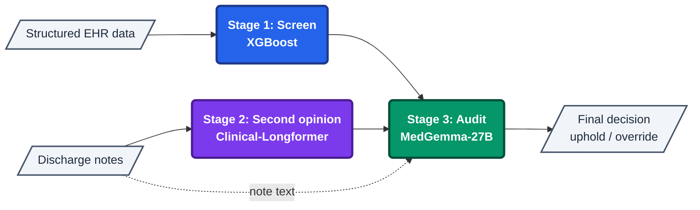

# Triage and Verify: A Large Language Model as Auditor of Structured 30-Day Readmission Alerts in MIMIC-IV

> **LLMs/agents working in this repo MUST read `PROJECT_TLDR.md`, `docs/ARCHITECTURE.md`, and the latest file in `sessions/` before starting work.**

A Master's thesis project at Nova SBE (M.Sc. Business Analytics) asking
whether a language model can improve 30-day readmission screening by
reviewing the alerts of a structured model — acting as an auditor — rather
than producing a risk score of its own. Full design rationale:
**`docs/ARCHITECTURE.md`**.

## The Idea

About one in five hospital patients is readmitted within 30 days. That is
costly for hospitals and harmful for patients. Hospitals already predict
this with algorithms trained on structured data: diagnoses, labs, length
of stay. But the practical problem is rarely discrimination — it is that
most alerts at a useful threshold are false, and clinicians who get too
many of them stop paying attention (alert fatigue). The question this
project asks is whether a language model that reads the discharge note can
**improve screening by reviewing those alerts — as an auditor — rather than
producing a risk score of its own.**

This project stacks three tools the way a hospital would actually deploy
them, and benchmarks the audited pipeline against the structured screen
alone at the **same number of alerts.**

1. **Screen:** a classical ML model flags high-risk patients from
   structured data alone, at an alert volume a hospital could actually
   act on, not a research-only recall floor that flags most of everyone.
2. **Independent second opinion:** a separate language model reads only
   the discharge note, with no structured data at all, and produces its
   own risk estimate independently of the first model, never gated by
   its flag.
3. **Audit:** an instruction-tuned medical language model, run locally,
   reviews the flagged cases. It reads both scores and the note, then
   reaches its own uphold or override decision with a justification.

We benchmark every layer against the simpler option alone, **at the
same number of alerts**, so "does more AI help" has an actual, falsifiable
answer rather than a vibe. All real MIMIC-IV data, all real local models:
no ChatGPT or Claude anywhere in the loop. Patient data never leaves
secure servers, and we train and run every model here on a university
GPU cluster, consistent with the PhysioNet Data Use Agreement governing
MIMIC-IV access.

## Implementation at a Glance

**Stage 1: XGBoost (structured screen).** Trained on the 416,949-admission training partition of a cohort of 521,191 MIMIC-IV
structured admissions, flags the top-K% highest-risk admissions at a
capacity-constrained operating point (default K=15%). Recall-floor is
kept as a secondary comparison table.

**Stage 2: Clinical-Longformer, note-only (independent risk estimate).**
A fine-tuned `yikuan8/Clinical-Longformer` (4096-token window) reads only
the discharge note of flagged patients, using no structured features, and
produces an independent risk estimate rather than a gate on Stage 1's
flag. We built a jointly-trained structured-plus-note "FusionLongformer"
variant and dropped it on 2026-08-26 without ever completing a training
run. See `docs/ARCHITECTURE.md` §2 for why.

**Stage 3: MedGemma-27B (independent auditor).** A local, instruction-tuned
medical language model, served via plain HF `transformers.generate()` with `lm-format-enforcer`
for guided, schema-constrained JSON decoding, temperature pinned at 0.
Switched from Ollama/phi4-mini on 2026-09-10 once the batch run moved to
cluster GPU hardware, then from vLLM on 2026-09-15 once KISSKI's CUDA
12.8 driver ceiling proved structurally incompatible with vLLM's
flashinfer and CUTLASS kernels. Reads Stage 1's score with its SHAP
reasons, Stage 2's score, a quantitatively computed discordance signal,
and the discharge note itself, then reaches its **own** uphold or
override judgment with a clinical justification. It does not narrate a
decision Stage 2 already made.

**Frontend:** a React, TypeScript, and Vite dashboard that visualises the
pipeline logic and patient-level results, useful for demos and thesis
presentations.

---

## Results

> Stage 1 and Stage 2 below are both real retrains. Stage 1 used a
> 400-trial Optuna search. Stage 2 used corrected age-group oversampling
> and a 4096-token window. Both target **unplanned** readmission, switched
> from all-cause on 2026-09-05 (every model trained before that date
> silently used all-cause, despite that always being the project's stated
> scope. See `docs/ARCHITECTURE.md` §6). See `MODEL_CARD.md` for the full
> breakdown, including per-age-group fairness metrics. Stage 3
> (MedGemma-27B via HF transformers) completed its full batch run (rerun
> merged 2026-11-21) across all 9,899 flagged-and-noted admissions.

### Stage 1: XGBoost (MIMIC-IV v3.1, n=521,191, held-out test n=104,242, target=unplanned)

| Metric | Value |
|--------|-------|
| AUROC | 0.7215 |
| AUPRC | 0.3965 (base rate 19.0%) |
| Recall @ thr=0.3235 (capacity=15%, primary policy) | 0.352 |
| Precision @ thr=0.3235 | 0.431 |
| F2 | 0.366 |

Recall-floor (secondary, for literature comparability): recall≥0.85 gives
precision=0.247. Beats 3 of 4 published benchmarks cited in `evaluate.py`
(LACE 0.694, Xiao 2018 0.715, Fraccaro 2016 0.684), behind Rajkomar 2018
(0.773). Weakest subgroup is age 70+ (AUROC 0.665, recall only 19.0% vs.
37.6–44.7% for other age bands). See `MODEL_CARD.md` for the full fairness
breakdown.

### Do the Structured and Note-Based Models Disagree on Individual Alerts? (RQ1)

RQ1 asks, beyond average discrimination, **to what extent the structured
and note-based models disagree on individual flagged admissions, and
whether that disagreement flags alerts more likely to be false.**

*Background — average discrimination.* We first score Stage 1 and Stage 2
independently on the identical population: 62,759 admissions that have a
discharge note, with neither model gating the other (the only population
both models can be fairly compared on).

| Model | AUROC |
|-------|-------|
| Stage 1 (structured) | 0.7093 |
| Stage 2 (notes only) | 0.7102 |
| Difference (Stage 2 − Stage 1) | +0.0009 [−0.0040, +0.0056] |

The confidence interval crosses zero: on average, the discharge note
carries no more, and no less, predictive signal than the 55
structured features alone.

*Disagreement on individuals.* The average hides what matters for an
auditor — whether the note points the *other way* for particular patients.
Among the 9,899 flagged-and-noted admissions, Stage 1's alerts are correct
less often on the admissions where the two models disagree (share of
correct alerts 0.412 on discordant vs. 0.445 on concordant admissions).
Disagreement does mark alerts that are more likely to be false, which is
the room an auditor has to work with.

### How Is the Auditor Designed, and Does It Behave as Intended? (RQ2)

RQ2 asks **how an LLM auditor can be designed to meet core requirements of
clinical deployment** — local processing of patient data, reproducible
decisions, verifiable evidence, and the option to abstain — and then checks
whether it does so in practice.

Stage 3 audits every admission that Stage 1 flagged and that also has a
discharge note: 9,899 admissions in total, a narrower and already
higher-risk slice of the population above. On just this subset, Stage 2's
own AUROC falls to 0.622, not because the model changed, but because
restricting to an already-flagged population removes most of the easy,
low-risk cases. This does not contradict the 0.7102 reported above; it is
the same model scored on a different, harder population.

For each of the 9,899 admissions, Stage 3 reads Stage 1's score with its
SHAP-ranked reasons, Stage 2's score, a quantitatively computed
discordance signal between the two, and the discharge note itself. It then
reaches its **own** uphold / override / insufficient-evidence decision with
a written justification, rather than narrating a decision Stage 2 already
made. Across the full run it upheld 8,095 alerts, overrode 1,566, and
abstained (`insufficient_evidence`) on 219; 19 answers were invalid and 0
inputs failed to prepare. Its own decision matched the code-recomputed
rule-based decision on 88.5% of decided admissions, and 93.1% of decided
admissions had every cited quote verified against the note.

Whether the auditor genuinely relies on its inputs was tested with four
validation control arms (n = 150). It does: with the note withheld it
abstained (`insufficient_evidence`) on **150 of 150** admissions; with
Stage 2's score withheld it changed ~11% of decisions (**89.3% agreement**
with the reference arm); the reference arm reproduced the main run on **145
of 150** decisions (96.7%), and a repeated run of identical inputs agreed
**100%**. The acceptance arm test passed **8/8**, and a batch-size check
(first 20, one at a time) found the decisions unchanged (100%) with grounds
agreeing 65%. See `docs/ARCHITECTURE.md` §3 and `MODEL_CARD.md`.

### Does the Auditor Improve Screening at Matched Alert Volume? (RQ3)

RQ3 is the confirmatory test: **does the audited pipeline beat the
structured model alone when both raise the same number of alerts?** Stage 3
audited all 9,899 flagged-and-noted admissions. The comparison uses a
patient-level **paired** bootstrap of the pipeline-minus-control difference.

1. **The blanket result.** At matched alert volume (14,638 alerts), the
   full three-stage cascade is slightly *below* Stage 1 alone (the control
   arm): precision difference −0.0048 (95% CI [−0.0085, −0.0015], excludes
   zero) and recall difference −0.0035 (95% CI [−0.0076, +0.0003], includes
   zero). The cascade's precision is lower (the interval excludes zero) and the
   recall difference's interval includes zero — a small net reduction, not a gain.
2. **Conditional triggering (exploratory).** Running Stage 3 only on cases
   where Stage 1 and Stage 2 disagree recovers recall against the blanket run
   using 4,631 fewer LLM calls (47%). But it raises more alerts (15,217 vs.
   14,638) and its own precision (0.437) is a touch below the blanket run's
   (0.439), so it should only be judged against its **own** matched control:
   there its precision difference is −0.0026 (95% CI [−0.0055, +0.0001]) and its
   recall difference −0.0020 (95% CI [−0.0049, +0.0008]) — both intervals
   include zero.
3. **The direct test (exploratory).** Comparing Stage 3's real decision
   against Stage 1's flag standing on its own, separately within agreeing
   and disagreeing cases, shows Stage 3 underperforms by F2 in both groups,
   more so on disagreeing cases.

The honest finding: the auditor trades a little recall for little-to-no
precision gain almost everywhere it is applied, and does not improve on the
structured screen at matched volume. Full numbers, confidence intervals and
caveats are in `MODEL_CARD.md`'s "Stage 1+2+3, combined pipeline" section
and `models/pipeline_paired_differences.json`.

---

## Quick Start: Without MIMIC (Synthetic Data)

No MIMIC access? The pipeline runs on synthetic data out of the box.

```bash
git clone https://github.com/ThesisNovaSBE/three-layer-readmission-audit.git && cd three-layer-readmission-audit
python -m venv .venv && source .venv/bin/activate
pip install -r requirements.txt

# Generate synthetic data + train Stage 1
python setup_demo.py
```

The synthetic generator creates fake patient records that match the MIMIC-IV column schema so all downstream code runs identically.

---

## Full Pipeline: With MIMIC Access

```bash
# 1. Configure data paths
cp .env.example .env   # edit MIMIC_IV_DIR and MIMIC_IV_NOTE_DIR

# 2. Install dependencies
python -m venv .venv && source .venv/bin/activate
pip install -r requirements.txt

# 3. Stage 1: train XGBoost
python -m src.model.train

# 4. Stage 2: fine-tune Clinical-Longformer on discharge notes
#    GPU/HPC (recommended): sbatch train_stage2.sh, see below
#    Local GPU:              python setup_stage2.py --mode full
python setup_stage2.py --mode full

# 5. Stage 3: on-demand audit for one patient, or batch (src/stage3/batch.py)
#    for every Stage 1-flagged, note-covered admission. Requires the
#    MedGemma-27B weights pre-downloaded (download_stage3_model.sh) and
#    lm-format-enforcer installed; cluster/GPU only, see docs/ARCHITECTURE.md §4:
python -m src.stage3.pipeline <hadm_id>
#    python -m src.stage3.batch          # full batch run
#    python -m src.stage3.batch --limit 10   # smoke test
```

---

## GPU / HPC Training (GWDG KISSKI)

Stage 2 training requires a capable GPU. The final run trained on 141,767 discharge summaries (validation 49,855); the original per-age-group target was ~249k but was not reached. The reference setup uses the GWDG KISSKI cluster (A100 80GB) via `train_stage2.sh`:

```bash
# On the cluster, submit the Slurm job
sbatch train_stage2.sh

# Monitor
squeue -u $USER
tail -f /projects/extern/kisski/kisski-nova-rpcl/dir.project/logs/stage2_<jobid>.log
```

**Email notifications.** The Slurm scripts set `--mail-type` but no longer hard-code
a recipient address. Pass your own at submit time if you want job emails:

```bash
sbatch --mail-user=<your-email> train_stage2.sh
sbatch --mail-user=<your-email> scripts/slurm_stage3_range.sh 0 5200 models/stage3_batch_results.csv
```

`train_stage2.sh` includes pre-flight checks (Stage 1 artifact, local
model cache, MIMIC-IV-Note path, CUDA) that fail fast with a clear
message before the expensive part of the job starts. Read its header
before adapting it to a different cluster.

---

## Frontend (Demo / Thesis Presentation)

```bash
cd frontend
npm install
npm run dev   # opens at http://localhost:5173
```

The dashboard has two views:
- **Pipeline:** a visual Stage 1 to 2 to 3 diagram with real metrics and a how-it-works explanation, for professor or committee presentations.
- **Patients:** a sortable table of flagged high-risk patients with Stage 1/2 scores. Click any row for the Stage 3 clinical explanation.

---

## Utility Scripts

| Script | Purpose |
|--------|---------|
| `setup_demo.py` | Synthetic data demo, no MIMIC needed |
| `setup_stage2.py` | Fine-tune Stage 2 end-to-end |
| `python -m src.stage3.pipeline <hadm_id>` | On-demand Stage 3 audit for one patient |
| `python -m src.stage3.batch` | Full batch audit, every Stage 1-flagged, note-covered admission |
| `train_stage2.sh` | Slurm job script for HPC/GPU training (GWDG KISSKI A100) |
| `diagnose_cluster.sh` | Cluster diagnostic job (checks env, GPU, paths) |
| `scripts/analyze_discordance_subgroups.py` | Stage 3 subgroup analysis (concordant vs. discordant) |
| `scripts/analyze_selection_bias.py` | Notes-covered vs. excluded baseline-characteristics comparison |
| `scripts/analyze_planned_return_crosscheck.py` | Stage 3's `planned_return` vs. the structured-data proxy |
| `scripts/run_validation_controls.py` | Stage 3 robustness checks: blind-note, no-Stage-2, self-agreement |

---

## Data Policy

> **MIMIC-IV data must NEVER be committed to this repository.**
>
> MIMIC-IV is governed by a PhysioNet Data Use Agreement.
> The `data/` directory and all `.csv`/`.joblib`/model weight files are gitignored.

---

## Pipeline



## Project Structure

```
├── PROJECT_TLDR.md              # Project context (read first)
├── MODEL_CARD.md                # Full model documentation + metrics
├── config.yaml                  # All configurable parameters
├── .pylintrc                    # Pylint config (target 10.00; last run 9.99)
├── setup_demo.py                # One-command demo (synthetic data)
├── setup_stage2.py              # Stage 2 fine-tuning runner
│                                 # (Stage 3 has no setup script: on-demand only, src/stage3/pipeline.py)
├── train_stage2.sh              # Slurm job script for GWDG KISSKI A100 80GB
├── scripts/                     # SLURM job scripts + standalone analysis scripts
│                                 # (see "Utility Scripts" above for what's in here)
├── frontend/                    # React + TS + Vite dashboard
│   └── src/
│       ├── components/          # PipelineDiagram, PatientTable, PatientModal
│       └── data/mockPatients.ts # Synthetic demo patients
├── src/
│   ├── config.py                # Config loader (returns AppConfig)
│   ├── config_schema.py         # Pydantic v2 AppConfig model tree
│   ├── schemas.py               # Column contracts
│   ├── data/
│   │   ├── cohort.py            # MIMIC-IV cohort extraction
│   │   ├── comorbidity.py       # Charlson comorbidity index
│   │   ├── features.py          # Feature engineering
│   │   └── synthetic.py         # Synthetic data generator
│   ├── model/                   # Stage 1: train, tune, evaluate, predict, cv,
│   │                             # calibration, bootstrap, compare_stages (RQ1),
│   │                             # evaluate_pipeline (RQ3 + control arm)
│   ├── stage2/
│   │   ├── _utils.py            # Shared helpers (band_key, model path)
│   │   ├── dataset.py           # ClinicalNotesDataset + note loading
│   │   ├── splits.py            # Patient-level finetune/val/cal splits
│   │   ├── train.py             # Fine-tune Clinical-Longformer (focal loss)
│   │   ├── calibrate.py         # Platt scaling + per-group threshold selection
│   │   ├── evaluate.py          # Stage 2 evaluation metrics
│   │   └── predict.py           # Stage 2 inference on Stage 1 flags
│   └── stage3/
│       ├── explain.py           # Prompt building, grounds taxonomy, MedGemma call
│       ├── discordance.py       # Percentile-rank displacement calc
│       ├── pipeline.py          # explain_patient(), the on-demand entry point
│       ├── batch.py             # Batch audit runner, every flagged, note-covered admission
│       ├── models.py            # ExplanationResult (Pydantic)
│       ├── attention.py         # Optional auxiliary attention-span extraction
│       └── shap_extract.py      # SHAP feature extraction from Stage 1
├── sessions/                    # Work session logs (read latest for context)
├── tests/                       # Unit & integration tests
├── docs/
│   ├── ARCHITECTURE.md          # Current pipeline design, read this first
│   ├── MODELING_PLAN.md         # Stage 1 modeling strategy
│   ├── STAGE3_VALIDATION.md     # Human-annotator (Cohen's kappa) validation plan
│   ├── THESIS_NARRATIVE.md      # Storytelling/framing guide for the thesis text
│   └── archive/                 # Superseded planning docs, kept for history
├── results/                     # Curated, committed copy of thesis-relevant result JSONs (aggregate-only)
├── data/                        # LOCAL ONLY, gitignored
└── models/                      # Canonical pipeline outputs + trained artifacts (JSONs tracked, binaries gitignored)
```

**Result files.** `models/*.json` are the **canonical** outputs the pipeline
writes; `results/` is a **curated, committed copy** of the thesis-relevant
subset (a stable, citable snapshot). Any file present in both folders is kept
byte-identical (`tests/test_results_models_parity.py`). All Chapter 4 numbers
are regenerated from these JSONs into `docs/THESIS_NUMBERS.md` by
`scripts/export_thesis_numbers.py`, each tagged with its source file and key.
