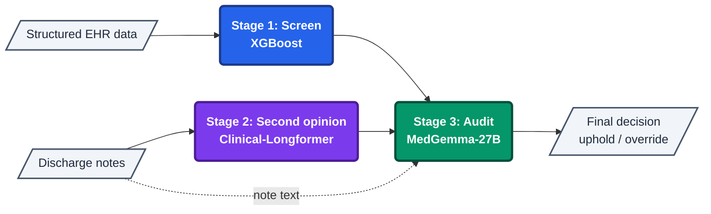

# LLM-Augmented Hospital Readmission Prediction

> **LLMs/agents working in this repo MUST read `PROJECT_TLDR.md`, `docs/ARCHITECTURE.md`, and the latest file in `sessions/` before starting work.**

A Master's thesis project at Nova SBE (M.Sc. Business Analytics) testing
whether LLMs add real value over classical ML for hospital readmission
prediction. Full design rationale: **`docs/ARCHITECTURE.md`**.

## The Idea

About one in five hospital patients is readmitted within 30 days. That is
costly for hospitals and harmful for patients. Hospitals already predict
this with algorithms trained on structured data: diagnoses, labs, length
of stay. The open question is whether large language models that read
doctors' free-text notes add real value on top of that, or whether it is
mostly hype.

This project stacks three tools the way a hospital would actually deploy
them, and asks the same question at every step: **does adding more AI
add value?**

1. **Screen:** a classical ML model flags high-risk patients from
   structured data alone, at an alert volume a hospital could actually
   act on, not a research-only recall floor that flags most of everyone.
2. **Independent second opinion:** a separate language model reads only
   the discharge note, with no structured data at all, and produces its
   own risk estimate independently of the first model, never gated by
   its flag.
3. **Audit:** a medical reasoning LLM acts like a senior doctor
   double-checking the flagged cases. It reads both scores and the note,
   then reaches its own uphold or override decision with a justification.

We benchmark every layer against the simpler option alone, **at the
same number of alerts**, so "does more AI help" has an actual, falsifiable
answer rather than a vibe. All real MIMIC-IV data, all real local models:
no ChatGPT or Claude anywhere in the loop. Patient data never leaves
secure servers, and we train and run every model here on a university
GPU cluster, consistent with the PhysioNet Data Use Agreement governing
MIMIC-IV access.

## Implementation at a Glance

**Stage 1: XGBoost (structured screen).** Trained on 521,191 MIMIC-IV
structured admissions, flags the top-K% highest-risk admissions at a
capacity-constrained operating point (default K=15%). Recall-floor is
kept as a secondary comparison table.

**Stage 2: Clinical-Longformer, note-only (independent risk estimate).**
A fine-tuned `yikuan8/Clinical-Longformer` (4096-token window) reads only
the discharge note of flagged patients, using no structured features, and
produces an independent risk estimate rather than a gate on Stage 1's
flag. We built a jointly-trained structured-plus-note "FusionLongformer"
variant and dropped it on 2026-08-26 without ever completing a training
run. See `docs/ARCHITECTURE.md` §2 for why.

**Stage 3: MedGemma-27B (independent auditor).** A local reasoning model,
served via plain HF `transformers.generate()` with `lm-format-enforcer`
for guided, schema-constrained JSON decoding, temperature pinned at 0.
Switched from Ollama/phi4-mini on 2026-09-10 once the batch run moved to
cluster GPU hardware, then from vLLM on 2026-09-15 once KISSKI's CUDA
12.8 driver ceiling proved structurally incompatible with vLLM's
flashinfer and CUTLASS kernels. Reads Stage 1's score with its SHAP
reasons, Stage 2's score, a quantitatively computed discordance signal,
and the discharge note itself, then reaches its **own** uphold or
override judgment with a clinical justification. It does not narrate a
decision Stage 2 already made.

**Frontend:** a React, TypeScript, and Vite dashboard that visualises the
pipeline logic and patient-level results, useful for demos and thesis
presentations.

---

## Results

> Stage 1 and Stage 2 below are both real retrains. Stage 1 used a
> 400-trial Optuna search. Stage 2 used corrected age-group oversampling
> and a 4096-token window. Both target **unplanned** readmission, switched
> from all-cause on 2026-09-05 (every model trained before that date
> silently used all-cause, despite that always being the project's stated
> scope. See `docs/ARCHITECTURE.md` §6). See `MODEL_CARD.md` for the full
> breakdown, including per-age-group fairness metrics. Stage 3
> (MedGemma-27B via HF transformers) completed its full batch run on
> 2026-10-06, across all 9,899 flagged-and-noted admissions.

### Stage 1: XGBoost (MIMIC-IV v3.1, n=521,191, held-out test n=104,242, target=unplanned)

| Metric | Value |
|--------|-------|
| AUROC | 0.7215 |
| AUPRC | 0.3965 (base rate 19.0%) |
| Recall @ thr=0.3235 (capacity=15%, primary policy) | 0.352 |
| Precision @ thr=0.3235 | 0.431 |
| F2 | 0.366 |

Recall-floor (secondary, for literature comparability): recall≥0.85 gives
precision=0.247. Beats 3 of 4 published benchmarks cited in `evaluate.py`
(LACE 0.694, Xiao 2018 0.715, Fraccaro 2016 0.684), behind Rajkomar 2018
(0.773). Weakest subgroup is age 70+ (AUROC 0.665, recall only 19.0% vs.
35–45% for other age bands). See `MODEL_CARD.md` for the full fairness
breakdown.

### Does the Discharge Note Add Signal Beyond Structured Data? (RQ1)

We score Stage 1 and Stage 2 independently on the identical population:
62,759 admissions that have a discharge note, with neither model gating
the other. This is the only population both models can be fairly compared
on, since Stage 2 can only ever score an admission that actually has a
note.

| Model | AUROC |
|-------|-------|
| Stage 1 (structured) | 0.7093 |
| Stage 2 (notes only) | 0.7101 |
| Difference | +0.0008 [-0.0041, +0.0054] |

The confidence interval crosses zero. **Null result**, expected and
reportable per this project's own design docs, not a failure of either
model. On this population, the discharge note carries no more, and no
less, predictive signal than the roughly forty structured features alone.

### Stage 3: MedGemma-27B, the Independent Auditor

Stage 3 audits every admission that Stage 1 flagged and that also has a
discharge note: 9,899 admissions in total, a narrower and already
higher-risk slice of the population above. On just this subset, Stage 2's
own AUROC falls to 0.622, not because the model changed, but because
restricting to an already-flagged population removes most of the easy,
low-risk cases that make a comparison informative in the first place.
This does not contradict the 0.7101 reported above. It is the same model
scored on a different, harder population. See `MODEL_CARD.md` for the
full explanation of why population choice moves the number this much.

For each of the 9,899 admissions, Stage 3 reads Stage 1's score with its
SHAP-ranked reasons, Stage 2's score, a quantitatively computed
discordance signal between the two, and the discharge note itself. It
then reaches its own uphold or override decision with a written
justification, rather than narrating a decision Stage 2 already made.

A separate robustness check is in progress: does the auditor actually
read the note, and does withholding Stage 2's score change its reasoning?
See `docs/ARCHITECTURE.md` §3 for status.

### Does the Auditor Add Value? (RQ2)

Full batch run: Stage 3 audited all 9,899 flagged-and-noted admissions.
Three results, each building on the last.

1. **The blanket result.** At matched alert volume, Stage 1 alone (the
   control arm) beats the full three-stage cascade on both precision
   (0.450 vs. 0.435) and recall (0.316 vs. 0.295, with 95% confidence
   intervals that essentially do not overlap). Auditing every flagged
   admission is net harmful, not neutral.
2. **Conditional triggering.** Running Stage 3 only on cases where
   Stage 1 and Stage 2 disagree recovers both precision and recall
   against the blanket run, using 48% fewer LLM calls.
3. **The direct test.** Comparing Stage 3's real decision against
   Stage 1's flag standing on its own, computed separately within
   agreeing and disagreeing cases, shows Stage 3 underperforms Stage 1
   alone in both groups by F2, and more so on the disagreeing cases, not
   less.

The honest finding: Stage 3 trades recall for little to no precision gain
almost everywhere it is applied. Full numbers, confidence intervals, and
caveats are in `MODEL_CARD.md`'s "Stage 1+2+3, combined pipeline" section.

---

## Quick Start: Without MIMIC (Synthetic Data)

No MIMIC access? The pipeline runs on synthetic data out of the box.

```bash
git clone https://github.com/ThesisNovaSBE/three-layer-readmission-audit.git && cd three-layer-readmission-audit
python -m venv .venv && source .venv/bin/activate
pip install -r requirements.txt

# Generate synthetic data + train Stage 1
python setup_demo.py
```

The synthetic generator creates fake patient records that match the MIMIC-IV column schema so all downstream code runs identically.

---

## Full Pipeline: With MIMIC Access

```bash
# 1. Configure data paths
cp .env.example .env   # edit MIMIC_IV_DIR and MIMIC_IV_NOTE_DIR

# 2. Install dependencies
python -m venv .venv && source .venv/bin/activate
pip install -r requirements.txt

# 3. Stage 1: train XGBoost
python -m src.model.train

# 4. Stage 2: fine-tune Clinical-Longformer on discharge notes
#    GPU/HPC (recommended): sbatch train_stage2.sh, see below
#    Local GPU:              python setup_stage2.py --mode full
python setup_stage2.py --mode full

# 5. Stage 3: on-demand audit for one patient, or batch (src/stage3/batch.py)
#    for every Stage 1-flagged, note-covered admission. Requires the
#    MedGemma-27B weights pre-downloaded (download_stage3_model.sh) and
#    lm-format-enforcer installed; cluster/GPU only, see docs/ARCHITECTURE.md §4:
python -m src.stage3.pipeline <hadm_id>
#    python -m src.stage3.batch          # full batch run
#    python -m src.stage3.batch --limit 10   # smoke test
```

---

## GPU / HPC Training (GWDG KISSKI)

Stage 2 training on 249k notes requires a capable GPU. The reference setup uses the GWDG KISSKI cluster (A100 80GB) via `train_stage2.sh`:

```bash
# On the cluster, submit the Slurm job
sbatch train_stage2.sh

# Monitor
squeue -u $USER
tail -f /projects/extern/kisski/kisski-nova-rpcl/dir.project/logs/stage2_<jobid>.log
```

`train_stage2.sh` includes pre-flight checks (Stage 1 artifact, local
model cache, MIMIC-IV-Note path, CUDA) that fail fast with a clear
message before the expensive part of the job starts. Read its header
before adapting it to a different cluster.

---

## Frontend (Demo / Thesis Presentation)

```bash
cd frontend
npm install
npm run dev   # opens at http://localhost:5173
```

The dashboard has two views:
- **Pipeline:** a visual Stage 1 to 2 to 3 diagram with real metrics and a how-it-works explanation, for professor or committee presentations.
- **Patients:** a sortable table of flagged high-risk patients with Stage 1/2 scores. Click any row for the Stage 3 clinical explanation.

---

## Utility Scripts

| Script | Purpose |
|--------|---------|
| `setup_demo.py` | Synthetic data demo, no MIMIC needed |
| `setup_stage2.py` | Fine-tune Stage 2 end-to-end |
| `python -m src.stage3.pipeline <hadm_id>` | On-demand Stage 3 audit for one patient |
| `python -m src.stage3.batch` | Full batch audit, every Stage 1-flagged, note-covered admission |
| `train_stage2.sh` | Slurm job script for HPC/GPU training (GWDG KISSKI A100) |
| `diagnose_cluster.sh` | Cluster diagnostic job (checks env, GPU, paths) |
| `scripts/analyze_discordance_subgroups.py` | Stage 3 subgroup analysis (concordant vs. discordant) |
| `scripts/analyze_selection_bias.py` | Notes-covered vs. excluded baseline-characteristics comparison |
| `scripts/analyze_planned_return_crosscheck.py` | Stage 3's `planned_return` vs. the structured-data proxy |
| `scripts/run_validation_controls.py` | Stage 3 robustness checks: blind-note, no-Stage-2, self-agreement |

---

## Data Policy

> **MIMIC-IV data must NEVER be committed to this repository.**
>
> MIMIC-IV is governed by a PhysioNet Data Use Agreement.
> The `data/` directory and all `.csv`/`.joblib`/model weight files are gitignored.

---

## Pipeline

Purely the technical data flow, with no research framing. See "The Idea"
above for that.



## Project Structure

```
├── PROJECT_TLDR.md              # Project context (read first)
├── MODEL_CARD.md                # Full model documentation + metrics
├── config.yaml                  # All configurable parameters
├── .pylintrc                    # Pylint config (enforces 10.00/10)
├── setup_demo.py                # One-command demo (synthetic data)
├── setup_stage2.py              # Stage 2 fine-tuning runner
│                                 # (Stage 3 has no setup script: on-demand only, src/stage3/pipeline.py)
├── train_stage2.sh              # Slurm job script for GWDG KISSKI A100 80GB
├── scripts/                     # SLURM job scripts + standalone analysis scripts
│                                 # (see "Utility Scripts" above for what's in here)
├── frontend/                    # React + TS + Vite dashboard
│   └── src/
│       ├── components/          # PipelineDiagram, PatientTable, PatientModal
│       └── data/mockPatients.ts # Synthetic demo patients
├── src/
│   ├── config.py                # Config loader (returns AppConfig)
│   ├── config_schema.py         # Pydantic v2 AppConfig model tree
│   ├── schemas.py               # Column contracts
│   ├── data/
│   │   ├── cohort.py            # MIMIC-IV cohort extraction
│   │   ├── comorbidity.py       # Charlson comorbidity index
│   │   ├── features.py          # Feature engineering
│   │   └── synthetic.py         # Synthetic data generator
│   ├── model/                   # Stage 1: train, tune, evaluate, predict, cv,
│   │                             # calibration, bootstrap, compare_stages (RQ1),
│   │                             # evaluate_pipeline (RQ2 + control arm)
│   ├── stage2/
│   │   ├── _utils.py            # Shared helpers (band_key, model path)
│   │   ├── dataset.py           # ClinicalNotesDataset + note loading
│   │   ├── splits.py            # Patient-level finetune/val/cal splits
│   │   ├── train.py             # Fine-tune Clinical-Longformer (focal loss)
│   │   ├── calibrate.py         # Platt scaling + per-group threshold selection
│   │   ├── evaluate.py          # Stage 2 evaluation metrics
│   │   └── predict.py           # Stage 2 inference on Stage 1 flags
│   └── stage3/
│       ├── explain.py           # Prompt building, grounds taxonomy, MedGemma call
│       ├── discordance.py       # Percentile-rank displacement calc
│       ├── pipeline.py          # explain_patient(), the on-demand entry point
│       ├── batch.py             # Batch audit runner, every flagged, note-covered admission
│       ├── models.py            # ExplanationResult (Pydantic)
│       ├── attention.py         # Optional auxiliary attention-span extraction
│       └── shap_extract.py      # SHAP feature extraction from Stage 1
├── sessions/                    # Work session logs (read latest for context)
├── tests/                       # Unit & integration tests
├── docs/
│   ├── ARCHITECTURE.md          # Current pipeline design, read this first
│   ├── MODELING_PLAN.md         # Stage 1 modeling strategy
│   ├── STAGE3_VALIDATION.md     # Human-annotator (Cohen's kappa) validation plan
│   ├── THESIS_NARRATIVE.md      # Storytelling/framing guide for the thesis text
│   └── archive/                 # Superseded planning docs, kept for history
├── results/                     # Final, citable result snapshots (aggregate-only)
├── data/                        # LOCAL ONLY, gitignored
└── models/                      # Trained artifacts, gitignored
```
